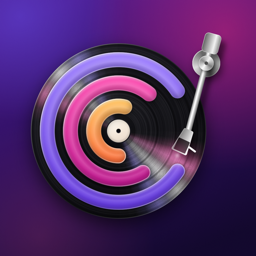
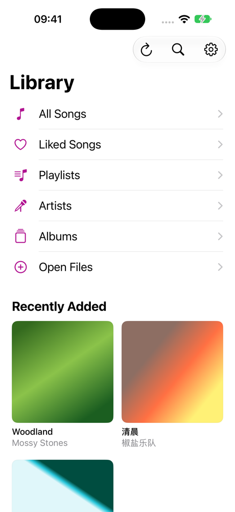
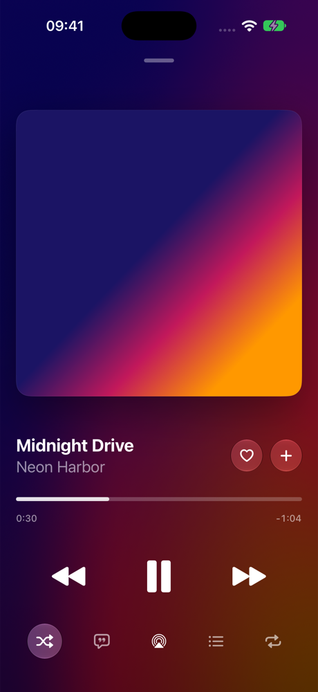
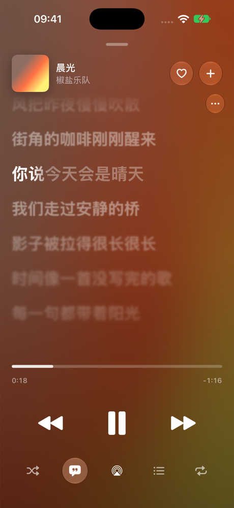
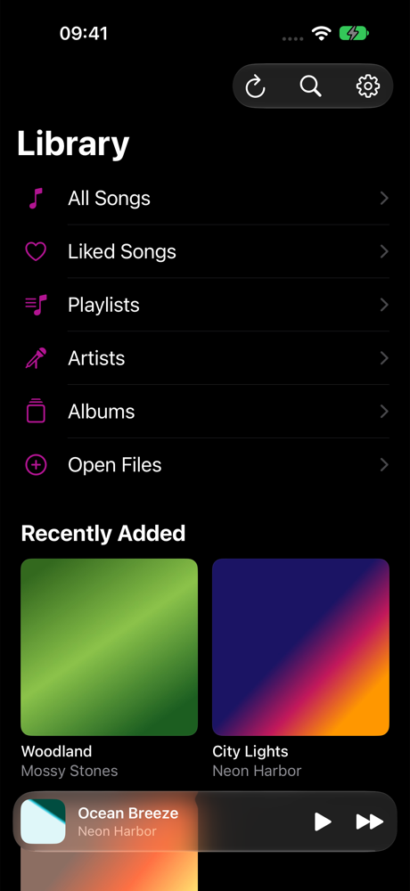

  

<h1 align="center">Cadence</h1>

An offline music player for iPhone, with a Liquid Glass interface, artwork-coloured Now Playing and Apple Music style synced lyrics.

  
  
  
  

> **Cadence is a fork of [Cosmos Music Player](https://github.com/clquwu/Cosmos-Music-Player) by Raphael Boullay.**
> It is not the official Cosmos Music Player app and is not endorsed by that project.
> The audio engine, library indexing, CarPlay, Siri and widget support come from Cosmos; Cadence reworks the interface and fixes a number of issues.

## What Cadence changes

**Interface (iOS 26 Liquid Glass, with a material fallback on iOS 18–25)**
- Now Playing: a slowly moving mesh gradient sampled from the artwork, artwork that settles back when paused, bare transport glyphs, an elastic scrubber, haptics throughout.
- The mini player is a glass card that zooms into the full player; pull down anywhere to close it again. Swipe the card to skip.
- In-place synced lyrics: the artwork shrinks into the header, lines fill word by word at the display's refresh rate with a feathered edge, and the list advances with a staggered spring. Tap a line to seek.
- Library, song and album screens on the plain system background with native large titles, glass toolbars, hairline separators and a Recently Added grid.

**Fixes**
- A missing `.env` file no longer crashes the app after the first library scan; online artist info is simply skipped.
- Library entries survive an app update or device restore that moves the app container (previously every song was duplicated and the originals stopped playing), and so does the song you were last playing.
- Play and pause answer on the tap. Pausing keeps the audio engine warm and fades out instead of clicking, the first Play after launch sets up the audio session off the main thread, and a pause no longer re-renders every song row behind the player.
- Skipping fades the old track out instead of cutting it off (the crackle on every skip), keeps the controls in their playing state while the next track loads, and no longer asks the phone speaker or AirPods for a sample rate they cannot run at on every track.
- Playback position, lyrics and the scrubber keep updating while a list is being scrolled.
- The lock screen / CarPlay cover no longer gets stuck on the wrong track after quick skips.
- Artwork mapping writes are batched off the main thread; CarPlay album covers load as thumbnails, one at a time.

## Requirements

- Xcode 26 or later (the project builds with the iOS 26+ SDK; deployment target iOS 18.5)
- An Apple ID for running on your own device, or an Apple Developer Program membership for TestFlight / App Store

## Building

1. Open `Cosmos Music Player.xcodeproj`.
2. For each target (app, PlayerWidget, Share, SiriIntentsExtension), select your team under *Signing & Capabilities* (the project is set to the maintainer's team).
3. The bundle identifiers use the prefix `io.github.ericchiuca.cadence`. If you build your own copy, change that prefix (and the matching `group.` and `iCloud.` identifiers in the entitlements) to one you own.
4. Optional: copy `.env.template` to `.env` and add Spotify / Discogs keys to enable online artist information. Without them the app works fully offline.

A free Apple ID cannot use iCloud, App Groups or Siri capabilities; remove them under *Signing & Capabilities* for a personal build. Apps signed with a free Apple ID expire after 7 days.

## Releasing on the App Store

See [docs/RELEASING.md](docs/RELEASING.md).

## License

Cadence is free software under the **GNU General Public License v3.0**, including the original project's *Apple App Store Distribution Exception* — see [LICENSE](LICENSE).

- Original work © Raphael Boullay and the Cosmos Music Player contributors.
- Modifications © 2026 Eric Chiu.

Under the GPL, anyone who receives the app is entitled to its source code; this repository is that source. The LICENSE's exception does not grant the name "Cosmos Music Player" or its branding, which is why this fork is named Cadence and uses its own icon.
